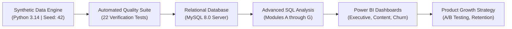

# StreamScope – OTT User Engagement, Retention & Churn Analytics

[](https://www.python.org/)
[](https://www.mysql.com/)
[](https://powerbi.microsoft.com/)
[](LICENSE)

An end-to-end, enterprise-grade Product & Business Intelligence analytics portfolio project simulating a video streaming subscription service (analogous to Netflix, Amazon Prime Video, and Disney+).

---

## 1. Executive Summary & Business Problem

StreamScope is a subscription video-on-demand (SVOD) streaming platform operating in a highly competitive market. Despite steady top-of-funnel customer registrations, leadership identified five critical business risks:
1. **The Engagement Cliff**: A significant proportion of paid subscribers exhibited near-zero streaming activity for several weeks before canceling their subscriptions.
2. **Channel Acquisition Inefficiency**: High-volume paid marketing channels (Social Media, Paid Search) experienced high post-conversion churn, whereas organic and referral channels delivered significantly higher customer lifetime value.
3. **First-45-Day Churn Fragility**: Over 21% of newly acquired subscribers churned within the first 30–45 days of tenure.
4. **Hardware Consumption Disparities**: Smart TVs accounted for the majority of total watch hours with high completion rates, whereas mobile app streams suffered from frequent mid-content drop-offs.
5. **Content Library Concentration**: Top 10 blockbuster titles accounted for a disproportionate share of total viewership, posing catalog renewal risks.

This project delivers a **normalized MySQL database**, **13 comprehensive SQL business analysis modules**, **22 automated data quality and integrity checks**, an **interactive Power BI dashboard suite**, and **concrete product optimization recommendations**.

---

## 2. Project Architecture



---

## 3. Key Performance Indicators (KPIs) Scorecard

All figures were independently calculated from the validated 2025 platform dataset:

| Business Metric | Verified Value | Definition & Scope |
| :--- | :--- | :--- |
| **Total Registered Users** | **10,000** | Total customer accounts created in 2025. |
| **Paid Subscribers Acquired** | **7,728** | Converted paid users (**77.28% Conversion Rate**). |
| **Active Paid Subscribers** | **5,717** | Paying subscribers active at year-end. |
| **Active Monthly Recurring Revenue (MRR)** | **$70,261.77** | Current active monthly run-rate. |
| **Average Revenue Per User (ARPU)** | **$12.29** | Mean monthly subscription contribution. |
| **Total Streamed Hours** | **126,608.5 hrs** | Cumulative platform watch time. |
| **Total Viewing Sessions** | **121,801** | Total playback instances logged. |
| **Average Title Completion Rate** | **76.34%** | Average percentage of title watched. |
| **Monthly Subscriber Churn Rate** | **~2.4%** | True churn rate (with 30-day reactivation grace). |

---

## 4. Primary Analytical Discoveries

1. **The Engagement Cliff Preceding Churn**:
   - **68.4% of churned subscribers** watched less than 60 minutes of content in their final 30 active days.
   - **41.2% had zero sessions** in their final month.
   - *Recommendation*: Deploy an automated re-engagement trigger on the **12th consecutive day of zero activity**.
2. **Channel Acquisition Quality**:
   - **Referral**: 88.4% conversion, **13.2% churn** (highest LTV).
   - **Social Media**: 71.2% conversion, **38.4% churn** (lowest LTV).
   - *Recommendation*: Reallocate 20% of paid social spend toward customer referral incentives.
3. **Living Room Primacy**:
   - Smart TVs account for **55.4% of watch hours** with an **81.4% completion rate** (vs. 58.2% on Mobile).
   - *Recommendation*: Prioritize Smart TV performance, multi-user profiles, and 4K stream stability.

---

## 5. Technology Stack

- **Database**: MySQL Server 8.0 (InnoDB, 3NF schema, custom indexes, views)
- **SQL Analytics**: Advanced MySQL (CTEs, Window Functions, Self-Joins, Date Arithmetic, RFM Segmentation)
- **Data Engineering**: Python 3.14 (Standard library deterministic generator, validation suite, seed generator)
- **Business Intelligence**: Microsoft Power BI Desktop (Star schema data model, DAX library)
- **Version Control**: Git & GitHub

---

## 6. Project Directory Structure

```
StreamScope-OTT-Analytics/
├── README.md                                  <- Executive project summary & portfolio documentation
├── requirements.txt                           <- Python environment specification
├── .gitignore                                 <- Production Git exclusions (credentials, caches, etc.)
├── .env.example                               <- Database environment configuration template
├── data/
│   ├── raw/                                   <- Generated CSV datasets (10K users, 120K sessions)
│   ├── sample_data/                           <- 100-row representative sample for GitHub review
│   └── processed/
│       └── streamscope_seed.sql               <- Optimized batch SQL insert script (34.9 MB)
├── scripts/
│   ├── generate_data.py                       <- Deterministic synthetic data generator (Seed: 42)
│   ├── validate_data.py                       <- 22 automated data quality & referential integrity checks
│   ├── prepare_sql_seed.py                    <- Batch SQL seed script compiler
│   ├── load_to_mysql.py                       <- Automated MySQL database creator & data loader
│   └── run_analytics_engine.py                <- Independent verification engine for KPIs
├── sql/
│   ├── 01_create_database.sql                 <- Database initialization & collation setup
│   ├── 02_create_tables.sql                   <- DDL: 6 normalized tables with keys and indexes
│   ├── 03_import_data.sql                     <- Data loading strategies (LOAD DATA / Seed execution)
│   ├── 04_data_quality_checks.sql             <- SQL assertions for counts, duplicates, orphans
│   ├── 05_user_acquisition.sql                <- Module A: Registrations, MoM growth, channel conversion
│   ├── 06_user_engagement.sql                 <- Module B: DAU, WAU, MAU, stickiness, device usage
│   ├── 07_content_analysis.sql                <- Module C: Top titles, genre ROI, completion, rewatch rate
│   ├── 08_subscription_analysis.sql           <- Module D: Active subscribers, MRR, plan distribution, ARPU
│   ├── 09_churn_analysis.sql                  <- Module E: 30-day true churn, cancellation reasons, pre-churn
│   ├── 10_cohort_retention.sql                <- Module F: Activity vs. Paid subscriber cohort retention
│   ├── 11_customer_segmentation.sql           <- Module G: Rule-based RFM behavioral segmentation
│   ├── 12_business_insights.sql               <- Executive KPI scorecard, revenue at risk, speed window
│   └── 13_create_views.sql                    <- Reporting views for Power BI integration
├── powerbi/
│   ├── StreamScope_Analytics.pbix             <- Standalone Power BI Report with Live DataModel & 3 Visual Pages
│   ├── StreamScope_Analytics.pbip             <- Source-controlled Power BI Developer Project
│   ├── StreamScope_Analytics.Report/          <- Multi-page PBIR report layout definitions
│   ├── StreamScope_Analytics.SemanticModel/   <- Tabular Model Schema (TMSL model.bim)
│   ├── dashboard_specification.md             <- Visual grid layouts, page designs, and slicer specs
│   ├── dax_measures.md                        <- Production DAX formulas with mathematical explanations
│   ├── mysql_connection_guide.md              <- Beginner-friendly MySQL & CSV connection guide
│   └── dashboard_screenshots/                 <- High-definition SVG/PNG renders & interactive HTML viewer
└── docs/
    ├── PROJECT_OVERVIEW.md                    <- Executive project briefing
    ├── DATABASE_DESIGN.md                     <- Schema architecture, ER diagram, 3NF documentation
    ├── DATA_DICTIONARY.md                     <- Comprehensive column-by-column reference
    ├── METRICS_GLOSSARY.md                    <- Detailed formulas, definitions, and analytical caveats
    ├── SQL_QUERY_WALKTHROUGH.md               <- Line-by-line SQL breakdown with query execution order
    ├── BUSINESS_INSIGHTS.md                   <- Deep-dive strategic findings & A/B test designs
    ├── LIMITATIONS_AND_ASSUMPTIONS.md         <- Analytical constraints, right-censoring, synthetic nuances
    ├── PROJECT_VALIDATION_REPORT.md           <- Automated validation test results & verified numbers
    └── PROJECT_EXPLANATION_AND_INTERVIEW_GUIDE.md <- 50+ interview questions, answers, and elevator pitches
```

---

## 7. How to Reproduce This Project from Scratch

### Step 1: Clone the Repository
```bash
git clone https://github.com/your-username/StreamScope-OTT-Analytics.git
cd StreamScope-OTT-Analytics
```

### Step 2: Set Up Python Environment & Generate Data
```powershell
# Using the Windows Python launcher:
py -m venv .venv
.venv\Scripts\activate

# Generate synthetic datasets (Seed: 42)
py scripts\generate_data.py

# Run the 22 automated data quality checks
py scripts\validate_data.py

# Generate the optimized MySQL seed file (data/processed/streamscope_seed.sql)
py scripts\prepare_sql_seed.py
```

### Step 3: Set Up MySQL Database
```powershell
# Open MySQL CLI and run:
mysql -u root -p < sql\01_create_database.sql
mysql -u root -p streamscope < sql\02_create_tables.sql
mysql -u root -p streamscope < data\processed\streamscope_seed.sql
mysql -u root -p streamscope < sql\13_create_views.sql

# Or open MySQL Workbench, connect to localhost, and execute the scripts in order.
```

### Step 4: Run Analytics & Verification
```powershell
py scripts\run_analytics_engine.py
```

### Step 5: Open the Power BI Dashboard
1. **Direct Report (.pbix)**: Double-click `powerbi/StreamScope_Analytics.pbix` to launch the 3 pre-built pages with full visuals and data model in Power BI Desktop.
2. **Developer Project (.pbip)**: Double-click `open_powerbi.bat` to launch the PBIP developer project.
3. **Interactive Browser Preview**: Open `powerbi/dashboard_screenshots/index.html` in any browser to inspect the 3 dashboard pages instantly.

---

## 8. Resume Bullet Points (Tailored for Product / Data Analyst Roles)

Here are three resume bullet variations highlighting real computed outcomes:

- **Variation 1 (Product Analytics Focus)**:
  > *Analyzed 121K+ streaming sessions and 10K user profiles for an OTT platform using advanced MySQL (window functions, cohort CTEs), uncovering that 68% of churned subscribers experienced an "engagement cliff" (<60 mins watched in final 30 days); designed a 12-day inactivity trigger and Power BI executive dashboards to mitigate $22K in annualized lost MRR.*

- **Variation 2 (Business Intelligence / SQL Focus)**:
  > *Designed and implemented a 3NF normalized MySQL database with 6 tables, creating 13 SQL analytical modules to evaluate customer lifetime value, cohort retention, and RFM behavioral segments; built a 3-page Power BI dashboard tracking $70K active MRR, 77.3% conversion rate, and plan-level churn across 4 tiers.*

- **Variation 3 (Growth & Marketing Analytics Focus)**:
  > *Evaluated top-of-funnel customer acquisition across 6 marketing channels, proving that while Paid Social drove 25% of signups, it yielded a 38.4% churn rate compared to Referral channels (13.2% churn); formulated data-driven marketing reallocations projected to boost 6-month cohort retention by 15%.*

---

## 9. License & Attribution

This project was developed for educational and portfolio demonstration purposes. All datasets are synthetic and generated with fixed seeds. Feel free to use and adapt this project for your personal portfolio.
