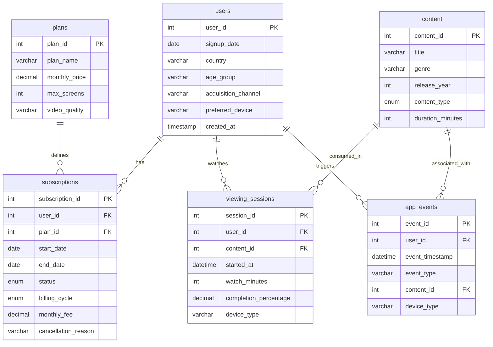

# StreamScope Relational Database Design & Schema Architecture

## Database Overview
- **Database Name**: `streamscope`
- **RDBMS Engine**: MySQL 8.0+ (InnoDB Engine)
- **Character Set / Collation**: `utf8mb4` / `utf8mb4_unicode_ci`
- **Normalization Level**: Third Normal Form (3NF)

---

## Entity-Relationship (ER) Diagram

---

## Detailed Table Specifications

### 1. `users` Table (Dimension)
Tracks demographic and top-of-funnel account registration details.

| Column | Data Type | Constraints | Description |
| :--- | :--- | :--- | :--- |
| `user_id` | `INT` | `PRIMARY KEY` | Unique customer identifier (1 to 10,000). |
| `signup_date` | `DATE` | `NOT NULL` | Calendar date of initial account creation. |
| `country` | `VARCHAR(50)` | `NOT NULL` | Geographic territory of user residence. |
| `age_group` | `VARCHAR(20)` | `NOT NULL` | Age bracket ('18-24', '25-34', '35-44', '45-54', '55+'). |
| `acquisition_channel` | `VARCHAR(50)` | `NOT NULL` | Marketing origin ('Organic Search', 'Social Media', 'Paid Search', 'Referral', 'Email Campaign', 'Affiliate'). |
| `preferred_device` | `VARCHAR(30)` | `NOT NULL` | Primary hardware declared during onboarding ('Smart TV', 'Mobile', 'Laptop', 'Tablet'). |
| `created_at` | `TIMESTAMP` | `DEFAULT CURRENT_TIMESTAMP` | System creation timestamp. |

**Indexes**:
- `idx_users_signup (signup_date)`: Accelerates cohort grouping by registration month.
- `idx_users_channel (acquisition_channel)`: Optimizes channel conversion and ROI aggregations.

---

### 2. `plans` Table (Dimension)
Defines the product catalog tiers, price points, and streaming feature entitlements.

| Column | Data Type | Constraints | Description |
| :--- | :--- | :--- | :--- |
| `plan_id` | `INT` | `PRIMARY KEY` | Unique identifier (1 to 4). |
| `plan_name` | `VARCHAR(50)` | `NOT NULL, UNIQUE` | Commercial plan name ('Basic with Ads', 'Standard HD', 'Premium 4K', 'Family Ultra'). |
| `monthly_price` | `DECIMAL(6,2)` | `NOT NULL` | Standard monthly subscription list price in USD ($6.99 to $21.99). |
| `max_screens` | `INT` | `NOT NULL` | Concurrency limit on simultaneous playback streams (1 to 4). |
| `video_quality` | `VARCHAR(30)` | `NOT NULL` | Entitled streaming resolution ('HD 720p', 'Full HD 1080p', '4K Ultra HD', '4K HDR + Atmos'). |

---

### 3. `subscriptions` Table (Fact / Lifecycle)
Captures historical and active recurring billing relationships. Designed to support multiple subscription cycles per user (renewals, plan upgrades, cancellations, and reactivations).

| Column | Data Type | Constraints | Description |
| :--- | :--- | :--- | :--- |
| `subscription_id` | `INT` | `PRIMARY KEY` | Unique transaction lifecycle record ID. |
| `user_id` | `INT` | `FOREIGN KEY (users.user_id)` | Linked subscriber. |
| `plan_id` | `INT` | `FOREIGN KEY (plans.plan_id)` | Linked subscription tier. |
| `start_date` | `DATE` | `NOT NULL` | Effective start date of the subscription period. |
| `end_date` | `DATE` | `NULL` | Cancellation / expiration date (`NULL` indicates ongoing active subscription). |
| `status` | `ENUM` | `'Active', 'Canceled', 'Expired'` | Current operational status of the subscription. |
| `billing_cycle` | `ENUM` | `'Monthly', 'Annual'` | Frequency of recurring payments. |
| `monthly_fee` | `DECIMAL(6,2)` | `NOT NULL` | Realized monthly fee (accounts for annual discount). |
| `cancellation_reason` | `VARCHAR(100)` | `NULL` | Stated churn reason recorded at cancellation. |

**Indexes**:
- `idx_subs_user_dates (user_id, start_date, end_date)`: Essential for non-overlapping interval validation and point-in-time active subscriber counts.
- `idx_subs_status (status)`: Fast filtering for active MRR calculations.

---

### 4. `content` Table (Dimension)
Catalog of feature films, documentaries, and serialized web series available in the streaming library.

| Column | Data Type | Constraints | Description |
| :--- | :--- | :--- | :--- |
| `content_id` | `INT` | `PRIMARY KEY` | Unique title identifier (1 to 80). |
| `title` | `VARCHAR(100)` | `NOT NULL` | Title name. |
| `genre` | `VARCHAR(50)` | `NOT NULL` | Primary content category (e.g., 'Sci-Fi & Fantasy', 'Action & Adventure'). |
| `release_year` | `INT` | `NOT NULL` | Initial public release year (2018–2025). |
| `content_type` | `ENUM` | `'Movie', 'Web Series'` | Content format. |
| `duration_minutes` | `INT` | `NOT NULL` | Total title runtime or representative episode duration (mins). |

---

### 5. `viewing_sessions` Table (Fact Table)
High-volume consumption fact table logging individual playback instances.

| Column | Data Type | Constraints | Description |
| :--- | :--- | :--- | :--- |
| `session_id` | `INT` | `PRIMARY KEY` | Unique stream session identifier. |
| `user_id` | `INT` | `FOREIGN KEY (users.user_id)` | Viewer who streamed the title. |
| `content_id` | `INT` | `FOREIGN KEY (content.content_id)` | Title streamed. |
| `started_at` | `DATETIME` | `NOT NULL` | Exact timestamp playback was initiated. |
| `watch_minutes` | `INT` | `NOT NULL` | Actual playback duration in minutes. |
| `completion_percentage` | `DECIMAL(5,2)` | `NOT NULL` | Percentage of title duration watched (`watch_minutes / duration * 100`). |
| `device_type` | `VARCHAR(30)` | `NOT NULL` | Hardware used for this specific stream ('Smart TV', 'Mobile', etc.). |

**Indexes**:
- `idx_sessions_user_date (user_id, started_at)`: Optimizes user-level engagement windowing and inactivity lag calculations.
- `idx_sessions_content (content_id)`: Accelerates title-level viewership aggregations.
- `idx_sessions_started_at (started_at)`: Speeds up DAU/WAU/MAU time-series slicing.

---

### 6. `app_events` Table (Fact Table)
Detailed clickstream telemetry logging navigational behavior across the digital product interface.

| Column | Data Type | Constraints | Description |
| :--- | :--- | :--- | :--- |
| `event_id` | `INT` | `PRIMARY KEY` | Unique clickstream event identifier. |
| `user_id` | `INT` | `FOREIGN KEY (users.user_id)` | User who triggered the action. |
| `event_timestamp` | `DATETIME` | `NOT NULL` | Timestamp of event occurrence. |
| `event_type` | `VARCHAR(50)` | `NOT NULL` | Action performed ('app_open', 'search', 'content_view', 'play', 'add_to_watchlist', 'subscription_start', 'cancellation'). |
| `content_id` | `INT` | `NULL, FK (content.content_id)` | Linked content (if event was content-specific). |
| `device_type` | `VARCHAR(30)` | `NOT NULL` | Client device executing the app. |

---

## Relational Integrity & Normalization Rationale

1. **First Normal Form (1NF)**: Every table has a primary key; columns contain only atomic, single-valued attributes.
2. **Second Normal Form (2NF)**: All non-key attributes are fully functionally dependent on the complete primary key (no partial dependencies).
3. **Third Normal Form (3NF)**: Transitive dependencies are eliminated. For instance, plan pricing and screen allowances exist solely in `plans`, not duplicated across millions of rows in `subscriptions`.
