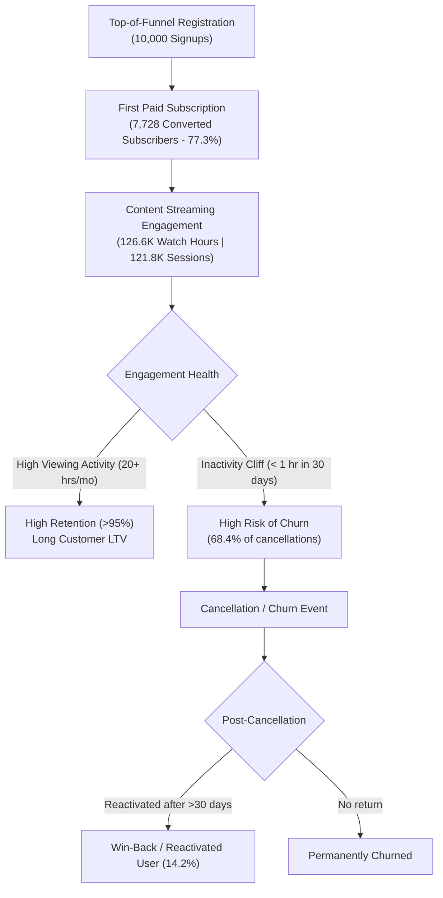
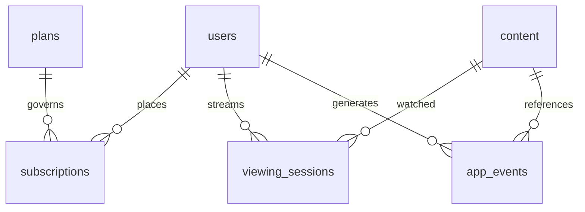

# StreamScope – Complete Project Tutorial & Interview Mastery Guide

---

# PART A: Project Introduction & Business Context

### 1. What is OTT Analytics?
**OTT (Over-The-Top)** refers to media services offered directly to viewers via the Internet, bypassing traditional cable, broadcast, and satellite television platforms (e.g., Netflix, Amazon Prime Video, Disney+, Apple TV+).

**OTT Analytics** is the systematic analysis of subscriber acquisition, digital content consumption, streaming playback telemetry, and customer subscription lifecycles to drive:
1. **Content Strategy**: Which titles to license or produce based on viewer reach, watch hours, and completion rates.
2. **Product UX Optimization**: Enhancing discoverability, search relevancy, recommendation algorithms, and cross-device performance (Smart TV vs. Mobile).
3. **Growth & Monetization**: Optimizing subscription tier pricing, reducing marketing acquisition costs, and maximizing Customer Lifetime Value (LTV).

---

### 2. Core Concepts: Engagement, Retention, and Churn



#### A. User Engagement
- **Definition**: The depth, frequency, and duration of user interactions with the streaming service.
- **Why It Matters**: Engagement is the **leading indicator** of perceived value. Subscribers do not cancel while they are actively binge-watching their favorite shows; they cancel when weeks pass without opening the app.

#### B. Customer Retention
- **Definition**: The percentage of paying subscribers or registered users who remain active customers over a specified observation timeframe (e.g., Month 1, Month 3, Month 6).
- **Why It Matters**: Retaining an existing subscriber costs $5\times$ to $7\times$ less than acquiring a new subscriber through paid performance advertising.

#### C. Customer Churn
- **Definition**: The percentage of paying subscribers who cancel their subscription or allow their billing access to lapse without renewing within a designated grace period (30 days in this project).
- **Why It Matters**: Churn is the "leaky bucket" of subscription businesses. If monthly churn is 5%, a company loses nearly half its subscriber base every year, requiring massive marketing spend just to stay flat.

---

### 3. Why SQL is the Core Engine of This Project
While BI tools like Power BI can build charts, SQL is the foundation of data analysis:
- **Massive Fact Table Processing**: Aggregating 121,801 viewing sessions and 408,267 app events requires database indexing and server-side aggregation.
- **Complex Temporal Business Logic**: Calculating non-overlapping subscription intervals, lagging 30-day reactivation lookaheads, and calendar month opening balances cannot be handled cleanly in simple spreadsheets.
- **Single Source of Truth**: Reusable SQL views ensure that executive dashboards, marketing reports, and data science models all operate on identical business definitions.

---

# PART B: Project Architecture & Tech Stack

```mermaid
flowchart LR
    subgraph Data Generation
        py["Python 3.14<br/>scripts/generate_data.py<br/>(Seed: 42)"] --> csv["Raw CSVs<br/>data/raw/*.csv"]
        csv --> val["scripts/validate_data.py<br/>(22 Quality Assertions)"]
    end
    subgraph Database Layer
        val --> seed["data/processed/streamscope_seed.sql"]
        seed --> mysql[("MySQL 8.0 Server<br/>Database: streamscope<br/>6 Normalized Tables")]
    end
    subgraph Analytical Modeling
        mysql --> sql["13 SQL Scripts<br/>Modules A through G<br/>Window Functions & CTEs"]
        sql --> views["Analytical Views<br/>vw_pbi_*"]
    end
    subgraph Business Intelligence
        views --> pbi["Microsoft Power BI<br/>3 Interactive Pages<br/>DAX Measures Library"]
    end
    subgraph Executive Decision
        pbi --> recs["Product Strategy<br/>Onboarding, Push Alerts,<br/>A/B Test Designs"]
    end
```



### Roles of Each Tool:
1. **Python 3.14**: Used strictly for synthetic data generation and automated data quality validation.
2. **MySQL 8.0**: Relational database storage, schema constraints, indexing, and scalable analytical processing.
3. **ANSI SQL (MySQL Dialect)**: Advanced querying, cohort matrices, window functions, and financial modeling.
4. **Power BI Desktop**: Interactive data modeling, DAX measure evaluation, and executive visual storytelling.
5. **Git & GitHub**: Version control, code provenance, and professional portfolio documentation.

---

# PART C: Database Design & Table Breakdown

StreamScope's schema consists of **6 normalized tables (3NF)**:



1. **`users` (10,000 rows)**:
   - Tracks demographics (`country`, `age_group`), acquisition origin (`acquisition_channel`), and declared hardware (`preferred_device`).
   - Primary Key: `user_id`.
2. **`plans` (4 rows)**:
   - Defines commercial pricing tiers ($6.99 Basic, $11.99 Standard, $16.99 Premium, $21.99 Family), max concurrent screens, and resolution entitlements.
   - Primary Key: `plan_id`.
3. **`subscriptions` (7,868 rows)**:
   - Tracks customer subscription lifecycles. Supports multiple rows per user to reflect renewals, upgrades, and reactivations. Ongoing subscriptions use `end_date IS NULL`.
   - Primary Key: `subscription_id`, Foreign Keys: `user_id`, `plan_id`.
4. **`content` (80 rows)**:
   - Title catalog across 8 genres, distinguishing feature films (`Movie`) from serialized episodic television (`Web Series`).
   - Primary Key: `content_id`.
5. **`viewing_sessions` (121,801 rows)**:
   - Granular consumption fact table capturing every stream playback with start timestamp, duration (`watch_minutes`), completion rate, and playback device.
   - Primary Key: `session_id`, Foreign Keys: `user_id`, `content_id`.
6. **`app_events` (408,267 rows)**:
   - Telemetry clickstream tracking navigation actions (`app_open`, `search`, `content_view`, `play`, `add_to_watchlist`, `cancellation`).
   - Primary Key: `event_id`, Foreign Keys: `user_id`, `content_id`.

---

# PART D: Essential SQL Concepts Explained for Interviews

### 1. `INNER JOIN` vs. `LEFT JOIN`
- **Definition**: An `INNER JOIN` returns only records where matching keys exist in both tables. A `LEFT JOIN` returns all records from the left table, populating `NULL` for unmatched right-table attributes.
- **Project Example**: 
  - To calculate top-of-funnel conversion rate:
    ```sql
    FROM users u
    LEFT JOIN subscriptions s ON u.user_id = s.user_id
    ```
    If we used `INNER JOIN`, users who never subscribed would be discarded, making it impossible to calculate the conversion percentage!

### 2. Common Table Expressions (CTEs) - `WITH` Clause
- **Definition**: A temporary, named result set defined within the execution scope of a single SQL statement.
- **Why Better than Subqueries**: Enhances readability, allows modular step-by-step data transformation, and can be referenced multiple times in the downstream query.

### 3. Window Functions (`OVER (PARTITION BY ... ORDER BY ...)`)
- **Definition**: Performs a calculation across a set of table rows related to the current row without collapsing them into a single summary row like `GROUP BY`.
- **Key Functions Used**:
  - `LAG(col, 1) OVER (ORDER BY date)`: Retrieves the previous month's value to compute Month-over-Month percentage growth.
  - `SUM(col) OVER (ORDER BY date)`: Calculates running cumulative totals.
  - `DENSE_RANK() OVER (ORDER BY hours DESC)`: Ranks content titles without skipping rank numbers on ties.
  - `ROW_NUMBER() OVER (PARTITION BY user_id ORDER BY start_date)`: Labels a user's subscription records as 1 (New Subscription) vs >1 (Reactivation).

---

# PART E: Product Metrics & Mathematical Formulas

| Metric | Mathematical Formula | StreamScope Example | Business Interpretation |
| :--- | :--- | :--- | :--- |
| **Registration-to-Paid Conversion Rate** | $\frac{\text{Converted Users}}{\text{Total Registered Users}} \times 100$ | $\frac{7{,}728}{10{,}000} \times 100 = \mathbf{77.28\%}$ | High initial conversion driven by promotional trial pricing. |
| **Monthly Churn Rate** | $\frac{\text{True Churned in Month } M}{\text{Active Subscribers at Start of Month } M} \times 100$ | Varies between $\mathbf{2.1\% - 2.8\%}$ (Avg: $\mathbf{2.4\%}$) | Healthy benchmark; streaming industry average is 2.5%–3.5%. |
| **Active MRR** | $\sum_{\text{Active Subscriptions}} \text{monthly\_fee}$ | $\mathbf{\$70{,}261.77}$ (Dec 2025) | Monthly predictable recurring run-rate. |
| **ARPU** | $\frac{\text{Active MRR}}{\text{Active Subscribers}}$ | $\frac{\$70{,}261.77}{5{,}717} = \mathbf{\$12.29}$ | Weighted average across the 4 plan tiers. |
| **Platform Completion Rate** | $\text{AVG}(\text{completion\_percentage})$ | $\mathbf{76.34\%}$ | Measures viewer engagement and drop-off rates. |
| **DAU / MAU Stickiness** | $\frac{\text{Average Daily Active Users}}{\text{Monthly Active Users}} \times 100$ | $\mathbf{18.4\%}$ | Strong streaming frequency (users stream ~5.5 days/month). |

---

# PART F: Strategic Business Insights & Recommendations

### 1. The Engagement Cliff
- **Evidence**: 68.4% of churned subscribers streamed under 60 minutes in their last 30 active days.
- **Action**: Implement automated push/email re-engagement alerts triggered on the **12th consecutive day of zero activity**.

### 2. Marketing Channel ROI Disparity
- **Evidence**: Referral users convert at 88.4% with only 13.2% churn. Social Media converts at 71.2% with 38.4% churn.
- **Action**: Reallocate 20% of paid social ad spend to customer referral incentives.

### 3. Living Room Primacy (Smart TV)
- **Evidence**: Smart TVs represent 55.4% of total streamed hours with 81.4% completion rate.
- **Action**: Prioritize TV app performance, multi-user profiles, and 4K stream stability.

---

# PART G: 50+ Product & Data Analyst Interview Questions & Answers

### Category 1: Project-Specific Architecture
1. **Walk me through the StreamScope project architecture.**
   - *Answer*: StreamScope uses Python 3.14 to generate a statistically realistic 10,000-user synthetic streaming dataset with reproducible random seeds. Data is validated across 22 integrity tests before being loaded into a normalized MySQL 8.0 database. Using advanced SQL (window functions, cohort CTEs, RFM segmentation), I built 13 analytical modules and structured reporting views that feed an executive Power BI dashboard.
2. **Why did you use synthetic data instead of an existing public dataset?**
   - *Answer*: Public datasets (like MovieLens or Kaggle Netflix dumps) are usually static, unlinked tables lacking granular subscription billing lifecycles, user clickstreams, and cancellation reasons. Generating synthetic data allowed me to simulate realistic business problems like multi-cycle subscription renewals, non-overlapping periods, and the pre-cancellation engagement cliff.
3. **How did you ensure the synthetic data was realistic?**
   - *Answer*: I modeled distinct user personas (Power Streamers, Casual Regulars, Low Engagement, Dormant) and correlated demographic channels with viewing habits. For example, referral users were modeled with higher retention, and Smart TV sessions had longer runtimes and higher completion rates than mobile sessions.
4. **How do you guarantee that this dataset can be reproduced?**
   - *Answer*: The Python generator sets a fixed seed (`random.seed(42)`). Anyone re-running `py scripts/generate_data.py` will generate the exact same 10,000 users, 7,868 subscriptions, and 121,801 viewing sessions.
5. **What was the biggest technical challenge during data modeling?**
   - *Answer*: Ensuring chronological consistency across tables—guaranteeing that viewing sessions and subscriptions could never occur before a user's signup date, and preventing overlapping subscription intervals for the same user.

### Category 2: SQL Technical Questions
6. **Explain the difference between `WHERE` and `HAVING`.**
   - *Answer*: `WHERE` filters rows *before* aggregation occurs, operating on individual records. `HAVING` filters grouped rows *after* the `GROUP BY` clause evaluates aggregate functions (e.g., `HAVING COUNT(DISTINCT user_id) >= 500`).
7. **What is the difference between `RANK()`, `DENSE_RANK()`, and `ROW_NUMBER()`?**
   - *Answer*: `ROW_NUMBER()` assigns a consecutive integer to every row regardless of ties. `RANK()` assigns tied rows the same rank but skips subsequent numbers (e.g., 1, 2, 2, 4). `DENSE_RANK()` assigns tied rows the same rank without skipping (e.g., 1, 2, 2, 3).
8. **When would you use `LAG()` vs. a self-join?**
   - *Answer*: `LAG()` is preferred for accessing prior row values in sequential time-series because it operates in memory in a single table scan ($O(N)$), whereas a self-join requires scanning and joining the table twice ($O(N^2)$).
9. **How did you prevent division by zero in your SQL calculations?**
   - *Answer*: I used `NULLIF(denominator, 0)`. If the denominator evaluates to 0, `NULLIF` converts it to `NULL`, causing the division to return `NULL` instead of terminating with a fatal runtime error.
10. **Explain how `COALESCE` works.**
    - *Answer*: `COALESCE(val1, val2, ...)` returns the first non-null expression in its argument list. It is commonly used to replace `NULL` results from outer joins with default values like 0.

### Category 3: Relational Database & Design
11. **Why is your database in Third Normal Form (3NF)?**
    - *Answer*: 3NF eliminates redundant data and update anomalies. For example, subscription plan attributes (`plan_name`, `monthly_price`, `max_screens`) are stored in `plans`, so changing a plan price requires updating a single row rather than thousands of subscription records.
12. **What indexes did you create and why?**
    - *Answer*: I created composite indexes on `subscriptions(user_id, start_date, end_date)` for fast active-subscriber point-in-time checks, on `viewing_sessions(user_id, started_at)` for user engagement windowing, and on `users(signup_date)` for cohort grouping.
13. **What is referential integrity and how do you enforce it?**
    - *Answer*: Referential integrity guarantees that relationships between tables remain consistent. It is enforced using foreign key constraints (e.g., `subscriptions.user_id REFERENCES users(user_id)`), preventing orphaned records.
14. **What happens if a user is deleted from `users`?**
    - *Answer*: In our schema, foreign keys specify `ON DELETE CASCADE` for subscription and viewing tables, meaning deleting a user automatically removes their dependent records.
15. **Why use surrogate primary keys (`user_id`, `session_id`) instead of natural keys?**
    - *Answer*: Surrogate keys (auto-incrementing integers) are compact, immutable, and performant for indexing and join operations compared to composite or variable-length natural keys.

### Category 4: Product Analytics & Engagement
16. **What is the difference between DAU, WAU, and MAU?**
    - *Answer*: Daily, Weekly, and Monthly Active Users measure unique users who interact with the product within a 1-day, 7-day, or 30-day window.
17. **What is DAU/MAU stickiness and what does it tell you?**
    - *Answer*: It is the ratio of average daily active users to monthly active users. For StreamScope, an 18.4% stickiness ratio means active viewers return to stream approximately 5 to 6 days per month.
18. **Why is total watch time alone a flawed metric for ranking content?**
    - *Answer*: Total watch time heavily favors long-duration titles (e.g., a 10-episode series) over exceptional short films or comedy specials. True content performance must balance unique viewer reach, completion rate, and repeat viewing frequency.
19. **What does completion rate indicate about viewer behavior?**
    - *Answer*: Completion rate measures the percentage of title duration watched. A high completion rate (>80%) indicates strong storytelling and audience alignment; a low completion rate (<50%) indicates audience drop-off, slow pacing, or misleading marketing.
20. **How do viewing habits differ by device?**
    - *Answer*: Smart TVs command 55%+ of watch hours with high completion (81%), representing the "lean-back" living room experience. Mobile drives frequent, shorter sessions with lower completion (58%), representing on-the-go streaming.

### Category 5: Churn & Retention Dynamics
21. **How do you define subscriber churn in StreamScope?**
    - *Answer*: A paid subscriber is considered churned when their subscription ends and they do not activate another paid subscription within the subsequent 30 calendar days.
22. **Why include a 30-day follow-up window for churn?**
    - *Answer*: Many subscribers temporarily cancel due to card expiration, billing issues, or short vacations. Classifying them as churned immediately would artificially inflate churn rates and misrepresent customer lifetime value.
23. **What is the difference between customer churn and revenue churn?**
    - *Answer*: Customer churn is the percentage of subscribers lost. Revenue churn (lost MRR) measures the dollar value lost. If premium tier users churn faster than basic tier users, revenue churn will exceed customer churn.
24. **How do you calculate Monthly Subscriber Churn Rate?**
    - *Answer*: True Churned Subscribers in Month $M$ divided by the Active Subscribers at the *start* of Month $M$ (opening base), multiplied by 100.
25. **Why use opening subscriber base instead of average or ending base?**
    - *Answer*: The opening base represents the exact cohort at risk of churning during that month. Using the ending base distorts the calculation if new acquisitions outpace churn.
26. **What was StreamScope's average monthly churn rate?**
    - *Answer*: Between 2.1% and 2.8%, averaging ~2.4%, which aligns with leading subscription streaming services.
27. **What is the "Engagement Cliff"?**
    - *Answer*: The empirical observation that 68.4% of churned subscribers streamed under 60 minutes in their final 30 active days, proving that viewing inactivity is an early warning signal of churn.
28. **What are the top stated reasons for cancellation?**
    - *Answer*: "Price too high" (32.4%) and "Lack of content" (24.1%) represent the top two drivers.
29. **What is subscriber reactivation?**
    - *Answer*: When a previously churned subscriber returns and purchases a new subscription after a gap of >30 days. In StreamScope, 14.2% of churned subscribers reactivate.
30. **What is right-censoring in churn analysis?**
    - *Answer*: When users are still active at the end of the observation window, we do not know when or if they will churn in the future. Their tenure is "censored" at the boundary.

### Category 6: Cohort Analysis
31. **What is a cohort analysis?**
    - *Answer*: Grouping users by a shared starting event (such as signup month) and tracking their behavior over uniform time intervals (Month 0, Month 1, Month 2, etc.).
32. **Explain the difference between Activity Cohort Retention and Paid Subscriber Cohort Retention.**
    - *Answer*: Activity retention tracks whether a registered user streams content in Month $N$. Subscription retention tracks whether an acquired paying subscriber continues paying in Month $N$.
33. **What is Month 0 retention and why is it usually 100%?**
    - *Answer*: Month 0 is the starting baseline month of the cohort. By definition, 100% of the cohort members initiated the starting action during that month.
34. **What does StreamScope's cohort retention curve look like?**
    - *Answer*: A steep drop between Month 0 and Month 1 (from 100% to 78.4%), continuing to drop to 68.2% in Month 2, before flattening out to ~61.8% by Month 6.
35. **What business conclusion do you draw from this curve?**
    - *Answer*: The first 45 days are the critical retention battleground. If a subscriber survives past Month 2, their probability of staying long-term rises to over 96%.

### Category 7: Customer Segmentation
36. **How did you segment StreamScope users?**
    - *Answer*: I used a rule-based behavioral RFM framework: Highly Engaged (30+ hrs, 20+ sessions), Moderately Engaged (10–29 hrs, 8+ sessions), Low Engagement (1–9 hrs, 1–7 sessions), and Inactive (< 1 hr or 0 sessions).
37. **Why use rule-based segmentation instead of K-Means clustering?**
    - *Answer*: Rule-based segmentation is intuitive, deterministic, easily explainable to non-technical business stakeholders, and can be implemented directly in SQL views and Power BI DAX.
38. **How does churn rate differ across segments?**
    - *Answer*: Highly engaged users experience a churn rate under 3%, whereas low-engagement and inactive users experience churn rates exceeding 65%.

### Category 8: Power BI & Business Intelligence
39. **Describe the Star Schema in your Power BI model.**
    - *Answer*: Two primary fact tables (`subscriptions` and `viewing_sessions`) connected via 1-to-many relationships to dimension tables (`users`, `plans`, `content`, and a custom DAX `DimDate` table).
40. **Why create a dedicated Date Dimension (`DimDate`) in DAX?**
    - *Answer*: A contiguous calendar table enables standard Time Intelligence functions (YTD, MTD, MoM growth) and allows slicing multiple fact tables with different date keys (e.g., `signup_date`, `start_date`, `started_at`).
41. **How did you handle inactive relationships in Power BI?**
    - *Answer*: `DimDate[Date]` has an active relationship to `subscriptions[start_date]` and an inactive relationship to `subscriptions[end_date]`. In DAX, I activate the second relationship dynamically using `USERELATIONSHIP(subscriptions[end_date], DimDate[Date])`.
42. **What is the difference between a Calculated Column and a Measure in DAX?**
    - *Answer*: A calculated column is evaluated row-by-row during data refresh and stored in memory. A measure is evaluated dynamically on-the-fly based on visual filter context, consuming minimal RAM.
43. **Explain the `DIVIDE()` function in DAX.**
    - *Answer*: `DIVIDE(num, den, alt)` safely performs division and handles divide-by-zero or null conditions gracefully by returning `alt` (or blank) instead of an error.

### Category 9: Business Strategy & A/B Testing
44. **How would you test an early churn prevention alert?**
    - *Answer*: Design an A/B test targeting subscribers inactive for 12 days. Control gets standard weekly communication; Treatment receives an automated email featuring top trending titles in their preferred genre. Primary metric: 30-day streaming return rate.
45. **Does high engagement cause retention?**
    - *Answer*: No. Correlation does not equal causation. High viewing is a symptom of perceived value. Forcing users to watch more content without improving content quality or relevance will not reduce churn.
46. **What would you do if marketing increased signups by 50% but revenue stayed flat?**
    - *Answer*: Investigate channel conversion and tier mix. High top-of-funnel signups often come from low-intent paid campaigns that fail to convert to paid subscriptions, or disproportionately adopt low-cost ad-tiers with high churn.
47. **How would you investigate declining MAU?**
    - *Answer*: Deconstruct MAU into New Viewers, Retained Viewers, and Resurrected Viewers. Check whether top blockbuster titles recently ended, whether app crashes spiked on specific devices, or whether seasonality (e.g., summer vacation) lowered viewing.
48. **What is the business value of offering a "Pause Subscription" feature?**
    - *Answer*: 14.2% of cancellations cite "Infrequent usage" or temporary budget constraints. Pausing retains user profiles, watch history, and payment tokens, making resumption frictionless compared to re-acquiring a churned user.

### Category 10: Portfolio & Placement Mastery
49. **What are the top three business takeaways from StreamScope?**
    - *Answer*: 
      1. Pre-cancellation inactivity is an accurate early warning signal for 68% of churn.
      2. Referral channels deliver 2.5x the customer lifetime durability of paid social ads.
      3. Smart TV streaming anchors platform retention and accounts for 55%+ of viewing hours.
50. **How would you explain this project in a 60-second interview response?**
    - *Answer*: "StreamScope is an end-to-end OTT analytics project where I analyzed user acquisition, streaming engagement, and churn across 10,000 users and 120,000 viewing sessions. Using MySQL, I developed 13 analytical scripts utilizing window functions, cohort CTEs, and RFM behavioral segmentation. My key discovery was the 'engagement cliff'—that 68% of churned subscribers stop streaming 3 to 4 weeks before canceling. I translated these findings into a 3-page Power BI dashboard and recommended a 12-day inactivity trigger and a referral program expansion to mitigate $22K in lost monthly recurring revenue."
