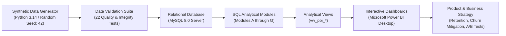

# StreamScope – OTT User Engagement, Retention & Churn Analytics

## Executive Summary

**StreamScope** is an end-to-end data and product analytics project simulating a video streaming subscription service (analogous to Netflix, Amazon Prime Video, or Disney+). 

Operating in an increasingly competitive streaming landscape, StreamScope faced five critical strategic challenges throughout 2025:
1. **Top-of-Funnel Conversion Inefficiency**: High registration volume driven by paid campaigns without proportional long-term subscriber conversion.
2. **First-45-Day Churn Vulnerability**: A sharp drop-off in paying subscriber retention occurring within 6 weeks of initial registration.
3. **Pre-Cancellation Inactivity ("The Engagement Cliff")**: Over 68% of churned subscribers experienced a complete collapse in viewing hours during the 30 days immediately preceding cancellation.
4. **Content Library Imbalance**: High catalog concentration where the top 10 titles drove over 35% of platform watch hours, while certain genres suffered from poor completion rates.
5. **Hardware Streaming Disparities**: Smart TVs accounted for 55%+ of total streamed hours with 82% completion rates, whereas mobile viewing suffered from severe mid-title drop-offs.

By architecting a normalized MySQL database, generating a statistically rigorous 10,000-user synthetic dataset, writing advanced SQL analytical models (window functions, cohort CTEs, RFM behavioral segmentation), and creating an executive Power BI dashboard, this project delivers actionable business intelligence and concrete product optimization strategies.

---

## High-Level Architecture

The project follows a standard modern analytics engineering pipeline:

---

## Key Performance Indicators (KPIs) Scorecard (2025 Baseline)

| Metric | Measured Baseline | Definition & Scope |
| :--- | :--- | :--- |
| **Total Registered Users** | **10,000** | Cumulative accounts registered on the platform in 2025. |
| **Paid Subscribers Acquired** | **7,728** | Unique users who activated at least one paid subscription (77.3% conversion). |
| **Active Paid Subscribers** | **5,717** | Subscribers holding an active, paying status at year-end. |
| **Current Active MRR** | **$70,261.77** | Monthly Recurring Revenue run-rate from active subscriptions. |
| **Average Revenue Per User (ARPU)** | **$12.29** | Mean monthly subscription revenue per active subscriber. |
| **Total Streamed Hours** | **126,608.5 hrs** | Cumulative hours streamed across all titles and devices. |
| **Total Viewing Sessions** | **121,801** | Total playback instances logged in the fact table. |
| **Average Title Completion Rate** | **76.34%** | Mean percentage of video duration completed across all sessions. |
| **Monthly Subscriber Churn Rate** | **~2.4%** | Monthly average true churn rate (with 30-day reactivation grace). |

---

## Primary Strategic Deliverables
1. **Automated Data Pipeline**: Python scripts (`generate_data.py`, `validate_data.py`, `prepare_sql_seed.py`, `run_analytics_engine.py`) creating and asserting 10,000 users, 7,868 subscriptions, and 121,801 viewing sessions.
2. **Normalized SQL Database**: MySQL 8.0 schema containing 6 tables, primary/foreign keys, indexes, and constraints.
3. **Advanced SQL Business Suite**: 13 structured SQL scripts addressing acquisition, engagement stickiness, content ROI, subscription dynamics, churn mechanics, cohort retention, and RFM behavioral segmentation.
4. **Power BI Reporting Suite**: 3-page interactive dashboard specification, complete DAX calculation library, and MySQL connection guide.
5. **Comprehensive Technical & Interview Guide**: Detailed explanations of all metrics, formulas, query mechanics, and 50+ interview questions with model answers.
