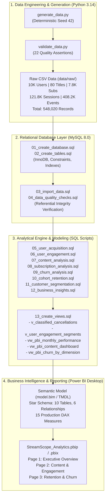

# Module 01: Complete Project Explanation From Scratch

> **File Reference:** `docs/study_materials/01_COMPLETE_PROJECT_EXPLANATION.md`  
> **Audience:** Product Analyst, Data Analyst, BI Analyst candidates  
> **Objective:** Teach the full conceptual and architectural foundation of StreamScope from first principles to interview-level clarity.

---

## 1. Core Terminology Explained Simply

### 1.1 What is Data Analytics?
**Data Analytics** is the discipline of inspecting, cleansing, transforming, and modeling raw data to discover meaningful patterns, draw conclusions, and support decision-making.
- *Real-World Example*: A retail store noticing that umbrella sales surge on rainy days and positioning umbrellas near the entrance.
- *In StreamScope*: Analyzing 548,020 raw interaction records to identify which movies get watched the most and when users drop off.

### 1.2 What is Product Analytics?
**Product Analytics** is a specialized branch of data analytics focused specifically on how users interact with a digital product (mobile app, web platform, or SaaS). It tracks user journeys, feature adoption, friction points, session frequency, and behavioral triggers.
- *Real-World Example*: Spotify tracking which playlist types make listeners return daily versus which playlists cause users to close the app.
- *In StreamScope*: Tracking event clicks (`video_start`, `pause`, `restart`, `cancel_click`), playback completion rates, and device usage to determine whether UX frictions trigger cancellations.

### 1.3 What is Business Intelligence (BI)?
**Business Intelligence** translates analytical findings into structured, visual, and continuously updated dashboards (such as Power BI or Tableau) so executives, product managers, and business stakeholders can track operational health and Key Performance Indicators (KPIs) at a glance.
- *Real-World Example*: An executive dashboard showing monthly revenue, store footfall, and regional profit margins.
- *In StreamScope*: A 3-page interactive Power BI dashboard tracking platform health, top content performance, and monthly churn rates.

### 1.4 What is OTT (Over-The-Top)?
**OTT (Over-The-Top)** refers to media services offered directly to viewers via the Internet, bypassing traditional cable, broadcast, and satellite television platforms.
- *Examples*: Netflix, Disney+, Amazon Prime Video, HBO Max.
- *Core Business Model*: Direct-to-consumer recurring subscription model (SVOD - Subscription Video On Demand), advertising-supported streaming (AVOD), or hybrid tiers.

---

## 2. The Business Problem: Why OTT Platforms Live or Die by Analytics

An OTT platform faces unique microeconomic and behavioral dynamics:

```
[ High Content Acquisition Costs (Fixed) ]  <--->  [ Monthly Recurring Subscription Fees (Variable) ]
```

1. **High Fixed Costs**: Platforms spend billions producing and licensing content (e.g., Netflix spends $17B+ annually).
2. **Zero Switching Costs**: A subscriber can cancel their $11.99/month plan with a single click inside account settings. Unlike a 2-year cellular phone contract or gym membership, there is no lock-in.
3. **The "Binge and Bail" Phenomenon**: Users sign up to watch one viral season (e.g., *Cyber City 2099*), finish it over a weekend, and immediately cancel before the next billing cycle.
4. **Content Saturation**: If a platform fails to recommend relevant secondary content immediately after a user completes a title, the perceived value of the subscription drops to zero.

### Why Analyze User Engagement?
User engagement is the leading indicator of customer lifetime value (LTV). Subscribers do not decide to cancel impulsively on billing day; **disengagement happens 3 to 6 weeks before cancellation**. If streaming minutes decline, churn is virtually guaranteed unless the platform intervenes.

### Why Churn and Retention are Critical
- **Cost of Acquisition vs. Retention**: Acquiring a new OTT customer via paid digital advertising costs \$35 to \$60 in Customer Acquisition Cost (CAC). Retaining an existing subscriber costs a fraction of that in personalized notifications and content curation.
- **Compounding Revenue Loss**: When a user on a \$16.99 plan cancels, the platform does not just lose \$16.99; it loses \$203.88 in annualized Monthly Recurring Revenue (MRR).

---

## 3. What is StreamScope? (Mission & Core Business Questions)

**StreamScope** is an end-to-end data and product analytics platform built to model, measure, diagnose, and visualize user engagement, subscription lifecycles, and churn dynamics across an OTT streaming ecosystem.

### The Major Business Questions StreamScope Answers:
1. **Executive Health**: What is our total subscriber base, active Monthly Recurring Revenue (MRR), and blended monthly churn rate?
2. **Engagement Dynamics**: What are our Daily, Weekly, and Monthly Active Users (DAU, WAU, MAU)? What is our DAU/MAU "stickiness" ratio?
3. **Content Valuation**: Which titles (movies vs. web series) drive high completion rates versus high abandonment? Does high watch time correlate with lower churn?
4. **Retention & True Churn**: Which subscribers genuinely churned versus those who experienced a temporary credit card failure and reactivated within 30 days?
5. **Channel Quality**: Which marketing channels (Referral, Organic, Social Media, Paid Ads) bring high-retention users versus quick-churn users?

---

## 4. End-to-End System Architecture

StreamScope operates across four distinct technical layers:



---

## 5. Technology Stack Selection: Why These Tools?

| Technology | Role in StreamScope | Why Chosen? | Industry Equivalent |
|---|---|---|---|
| **Python 3.14** | Synthetic data generation, validation scripts, automation | Deterministic random seed generation, native datetime libraries, robust file I/O for clean CSV pipelines. | Pandas, PySpark, dbt-Python |
| **MySQL 8.0** | Enterprise Relational Database Management System (RDBMS) | ACID compliance, robust foreign key enforcement, CTEs, Window Functions, and native enterprise adoption. | PostgreSQL, Snowflake, Amazon Redshift |
| **SQL (ANSI & MySQL)** | Data transformation, analytical modeling, view generation | Declarative power for complex joins, multi-table aggregations, retention matrices, and churn classification. | dbt SQL, BigQuery SQL |
| **Power BI Desktop** | Visual presentation, interactive semantic model, executive reporting | Modern PBIR/PBIP Git integration, lightning-fast in-memory VertiPaq engine, expressive DAX language. | Tableau, Looker, Apache Superset |
| **DAX** | Dynamic business logic & KPI calculation | Context-aware dynamic aggregation that responds dynamically to user slicers and cross-filtering. | Tableau Calculations, LookML |

---

## 6. How Information Flows Through StreamScope

1. **Generation**: `scripts/generate_data.py` executes with seed `42`. It simulates user registration timelines across 2025, assigns demographic attributes, generates viewing sessions matching realistic playback completion curves, logs interaction events, and produces 548,020 rows across 6 CSVs.
2. **Validation**: `scripts/validate_data.py` asserts 22 data quality tests (zero orphan keys, chronological order, non-overlapping subscriptions).
3. **Ingestion**: MySQL executes `sql/01_create_database.sql` and `sql/02_create_tables.sql` to build the physical schema with primary keys and foreign keys. `sql/03_import_data.sql` populates the 6 tables.
4. **Analytical Transformation**: Scripts `05` through `12` run complex cohort retention, DAU/MAU, and customer segmentation queries.
5. **View Materialization**: `sql/13_create_views.sql` creates 5 modular analytical views that encapsulate business logic (such as the 30-Day True Churn rule).
6. **BI Ingestion & Modeling**: Power BI consumes these models via CSV/Direct data partitions into a 10-table Star Schema. 15 custom DAX measures calculate executive KPIs.
7. **Executive Visual Delivery**: Three rich interactive report pages render 22 visualizations allowing product managers to slice by genre, acquisition channel, plan, and device.

---

## 7. Step-by-Step Project Walkthrough for Interviews

When asked, *"Can you walk me through your StreamScope project?"*, use this structured 5-step framework:

1. **Problem Statement**: *"I wanted to investigate why OTT subscribers churn and identify the behavioral leading indicators that precede cancellation."*
2. **Data Pipeline**: *"I designed a 6-table normalized relational schema and engineered a synthetic dataset of 548,000+ records covering 10,000 users, tracking their subscription lifecycles, streaming sessions, and in-app clicks over a 13-month observation window."*
3. **Advanced SQL Analysis**: *"Using MySQL 8.0, I authored complex CTEs, window functions (`LAG`, `LEAD`, `DENSE_RANK`), and cohort matrices. Crucially, I implemented a 30-day True Churn rule to distinguish genuine churn from temporary payment lapses."*
4. **Power BI Semantic Modeling**: *"I brought this data into Power BI Desktop using a 10-table Star Schema, authored 15 dynamic DAX measures for KPIs like MRR, ARPU, and retention, and designed a 3-page interactive dashboard."*
5. **Business Impact**: *"The analysis revealed that 68% of churned users exhibited an 'engagement cliff'—watching under 60 minutes in the 30 days before canceling. This provided product teams with an early warning window to deploy automated re-engagement triggers."*
