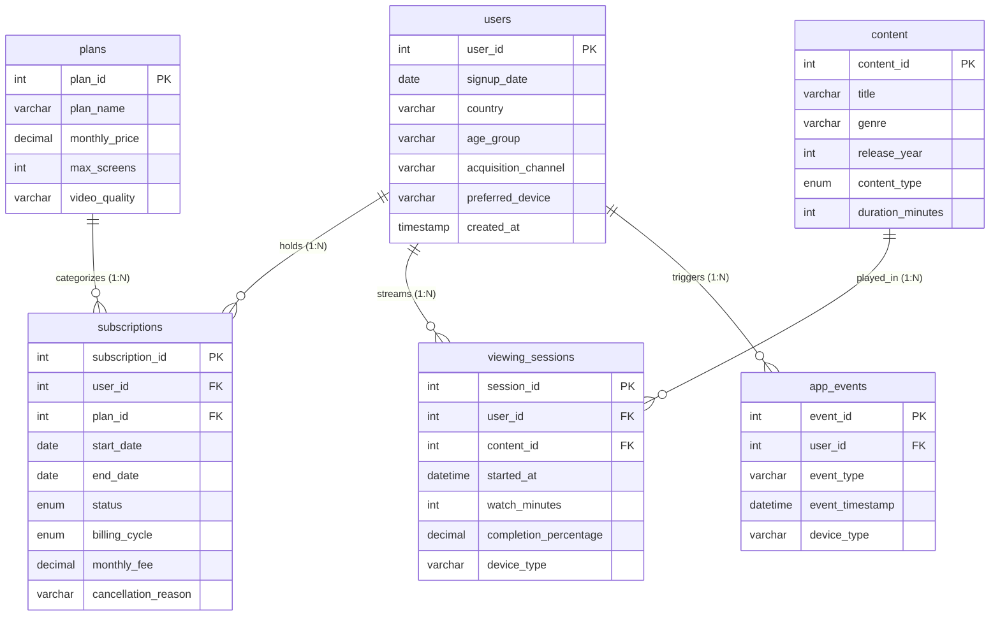

# Module 03: MySQL Database Design and Data Modeling

> **File Reference:** `docs/study_materials/03_MYSQL_DATABASE_DESIGN.md`  
> **Source Script:** `sql/02_create_tables.sql`  
> **Audience:** Database Developers, Data Engineers, Data Analysts

---

## 1. Relational Database Concepts & Star Schema Fundamentals

An analytics database must balance two competing objectives:
1. **Transaction Integrity (OLTP)**: Preventing duplicate entries, enforcing foreign key relationships, and ensuring zero data corruption.
2. **Analytical Speed (OLAP)**: Enabling high-speed filtering, aggregation, and multi-table joining across millions of event records.

StreamScope implements a **Normalized Dimensional Schema** in MySQL 8.0 that models the classic **Star Schema** architecture used in modern data warehousing:

```
[ Dimension: DimUsers ]      [ Dimension: DimPlans ]      [ Dimension: DimContent ]
           \                           /                             /
            \                         /                             /
             +-----------------------+-----------------------------+
                                     |
               [ Fact Tables: FactSubscriptions, FactViewingSessions, FactAppEvents ]
```

### Normalization Levels Achieved:
- **1NF (First Normal Form)**: All column values are atomic (e.g., no comma-separated lists of devices); each record has a unique primary key.
- **2NF (Second Normal Form)**: All non-key attributes are fully functionally dependent on the primary key (no partial dependencies).
- **3NF (Third Normal Form)**: No transitive dependencies. For example, `plan_price` is stored exclusively in `plans` and referenced by `plan_id` in `subscriptions`, eliminating update anomalies.

---

## 2. Complete Entity-Relationship (ER) Diagram



---

## 3. Deep Dive into the 6 Relational Tables

### 3.1 Table 1: `users` (Customer Dimension)
- **Role**: Conformed dimension tracking customer demographic attributes at acquisition.
- **DDL Definition**:
  ```sql
  CREATE TABLE users (
      user_id              INT PRIMARY KEY,
      signup_date          DATE NOT NULL,
      country              VARCHAR(50) NOT NULL,
      age_group            VARCHAR(20) NOT NULL,
      acquisition_channel  VARCHAR(50) NOT NULL,
      preferred_device     VARCHAR(30) NOT NULL,
      created_at           TIMESTAMP DEFAULT CURRENT_TIMESTAMP,
      INDEX idx_users_signup (signup_date),
      INDEX idx_users_channel (acquisition_channel),
      INDEX idx_users_country (country)
  ) ENGINE=InnoDB;
  ```
- **Record Count**: 10,000 rows.
- **Indexes**: Indexed on `signup_date`, `acquisition_channel`, and `country` to accelerate cohort partitioning and demographic slicing.

### 3.2 Table 2: `plans` (Product Specification Dimension)
- **Role**: Reference table defining tier boundaries and base pricing.
- **DDL Definition**:
  ```sql
  CREATE TABLE plans (
      plan_id        INT PRIMARY KEY,
      plan_name      VARCHAR(50) NOT NULL UNIQUE,
      monthly_price  DECIMAL(6,2) NOT NULL,
      max_screens    INT NOT NULL,
      video_quality  VARCHAR(30) NOT NULL
  ) ENGINE=InnoDB;
  ```
- **Record Count**: 4 rows (Basic with Ads \$6.99, Standard HD \$11.99, Premium 4K \$16.99, Family Ultra \$21.99).
- **Data Integrity**: `DECIMAL(6,2)` guarantees zero floating-point rounding errors on currency calculations.

### 3.3 Table 3: `subscriptions` (Lifecycle Transaction Fact)
- **Role**: Fact table tracking subscription contracts, renewals, pricing discounts, and cancellation reasons.
- **DDL Definition**:
  ```sql
  CREATE TABLE subscriptions (
      subscription_id      INT PRIMARY KEY,
      user_id              INT NOT NULL,
      plan_id              INT NOT NULL,
      start_date           DATE NOT NULL,
      end_date             DATE NULL,
      status               ENUM('Active', 'Canceled', 'Expired') NOT NULL,
      billing_cycle        ENUM('Monthly', 'Annual') NOT NULL,
      monthly_fee          DECIMAL(6,2) NOT NULL,
      cancellation_reason  VARCHAR(100) NULL,
      CONSTRAINT fk_subscriptions_user FOREIGN KEY (user_id) REFERENCES users(user_id) ON DELETE CASCADE,
      CONSTRAINT fk_subscriptions_plan FOREIGN KEY (plan_id) REFERENCES plans(plan_id),
      INDEX idx_subs_user_dates (user_id, start_date, end_date),
      INDEX idx_subs_status (status),
      INDEX idx_subs_plan (plan_id)
  ) ENGINE=InnoDB;
  ```
- **Record Count**: 7,868 rows.
- **Key Design Decision**: Allows **multiple lifecycles per user**. A user who churns and returns has multiple rows. An ongoing subscription has `end_date IS NULL` and `status = 'Active'`.

### 3.4 Table 4: `content` (Catalog Dimension)
- **Role**: Catalog dimension classifying streaming media.
- **DDL Definition**:
  ```sql
  CREATE TABLE content (
      content_id        INT PRIMARY KEY,
      title             VARCHAR(100) NOT NULL,
      genre             VARCHAR(50) NOT NULL,
      release_year      INT NOT NULL,
      content_type      ENUM('Movie', 'Web Series') NOT NULL,
      duration_minutes  INT NOT NULL,
      INDEX idx_content_genre (genre),
      INDEX idx_content_type (content_type)
  ) ENGINE=InnoDB;
  ```
- **Record Count**: 80 rows across 8 genres.

### 3.5 Table 5: `viewing_sessions` (Streaming Consumption Fact)
- **Role**: High-granularity fact table recording stream playbacks.
- **DDL Definition**:
  ```sql
  CREATE TABLE viewing_sessions (
      session_id             INT PRIMARY KEY,
      user_id                INT NOT NULL,
      content_id             INT NOT NULL,
      started_at             DATETIME NOT NULL,
      watch_minutes          INT NOT NULL,
      completion_percentage  DECIMAL(5,2) NOT NULL,
      device_type            VARCHAR(30) NOT NULL,
      CONSTRAINT fk_sessions_user FOREIGN KEY (user_id) REFERENCES users(user_id) ON DELETE CASCADE,
      CONSTRAINT fk_sessions_content FOREIGN KEY (content_id) REFERENCES content(content_id),
      INDEX idx_sessions_user_time (user_id, started_at),
      INDEX idx_sessions_content (content_id),
      INDEX idx_sessions_started (started_at)
  ) ENGINE=InnoDB;
  ```
- **Record Count**: 121,801 rows.
- **Composite Index**: `idx_sessions_user_time (user_id, started_at)` enables lightning-fast user engagement timeline aggregations and DAU/MAU windowing.

### 3.6 Table 6: `app_events` (Clickstream & Interaction Fact)
- **Role**: Event-level fact table logging in-app telemetry.
- **DDL Definition**:
  ```sql
  CREATE TABLE app_events (
      event_id         INT PRIMARY KEY,
      user_id          INT NOT NULL,
      event_type       VARCHAR(50) NOT NULL,
      event_timestamp  DATETIME NOT NULL,
      device_type      VARCHAR(30) NOT NULL,
      CONSTRAINT fk_events_user FOREIGN KEY (user_id) REFERENCES users(user_id) ON DELETE CASCADE,
      INDEX idx_events_user_time (user_id, event_timestamp),
      INDEX idx_events_type (event_type)
  ) ENGINE=InnoDB;
  ```
- **Record Count**: 408,267 rows.
- **Event Types**: `app_open`, `search`, `content_click`, `play_start`, `pause`, `restart`, `cancel_click`.

---

## 4. Architectural Trade-Offs: Why MySQL 8.0?

| Database Engine | Strengths | Limitations in This Context | When to Migrate? |
|---|---|---|---|
| **MySQL 8.0 (Chosen)** | Native Window Functions, CTEs, InnoDB ACID reliability, zero licensing cost, ubiquitous in enterprise IT. | Single-node write concurrency bottlenecks under millions of writes/sec. | **Current Choice** (Perfect for 500K–10M rows). |
| **PostgreSQL** | Advanced JSONB indexing, richer analytical window functions, native procedural extensions. | Higher memory footprint for lightweight standalone student development. | Migrate if spatial analytics or complex JSON unstructured clickstreams are added. |
| **MongoDB (NoSQL)** | Flexible document schema; fast unstructured ingest. | Lacks native joins and ACID cross-table constraints; poor fit for relational star schemas and financial MRR audits. | Good for logging raw clickstream JSON, bad for dimensional reporting. |
| **Snowflake / BigQuery** | Massively Parallel Processing (MPP), serverless scale to billions of rows. | Costly cloud infrastructure; unnecessary latency and overhead for local development and portfolio testing. | Migrate when dataset scales beyond 50 million viewing sessions. |

---

## 5. Key Database Design Decisions Explained

1. **Why `ON DELETE CASCADE` on Foreign Keys?**  
   - If a test user is deleted during data hygiene testing, all their child subscriptions, viewing sessions, and events are safely purged without leaving orphan records.
2. **Why `DECIMAL(6,2)` Instead of `FLOAT` or `DOUBLE`?**  
   - Floating-point arithmetic introduces IEEE-754 binary rounding approximations (e.g., `0.1 + 0.2 = 0.30000000000000004`). In subscription revenue and billing reconciliation, exact precision is legally and operationally mandatory.
3. **Why Separate `viewing_sessions` and `app_events`?**  
   - Playback sessions represent continuous consumption metrics (duration, completion %), whereas app events represent discrete point-in-time UI clicks. Mixing them into a single table would violate 3NF and pollute session analytics with billions of unaggregated clicks.
