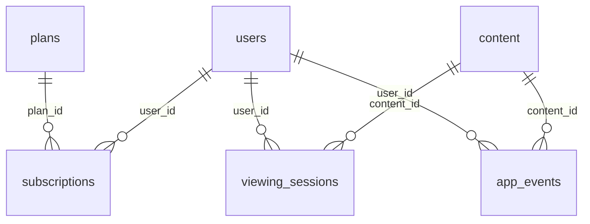

# StreamScope Power BI Dashboard Specification

## Overview & Architecture

The StreamScope Power BI reporting suite is designed as an executive and product-operational analytics workspace consisting of **three dedicated reporting pages**:
1. **Executive Overview**: High-level platform health, top-line revenue, active subscriber growth, and overall engagement trends.
2. **Content & Engagement Performance**: Deep dive into catalog consumption, top titles, completion rates, genre demand, and hardware streaming preferences.
3. **Retention & Churn Dynamics**: Comprehensive diagnosis of customer churn, plan and acquisition channel health, reasons for leaving, and cohort retention.

---

## Data Model Architecture (Star Schema)

For optimal Power BI performance and clean DAX calculations, use the following Star Schema:

### Table Roles
- **Fact Tables**:
  - `viewing_sessions` (Granularity: 1 row per stream playback session)
  - `subscriptions` (Granularity: 1 row per subscription tenure period)
  - `app_events` (Granularity: 1 row per user clickstream action)
- **Dimension Tables**:
  - `users` (User demographics, signup date, acquisition channel, country)
  - `content` (Title metadata, genre, runtime, release year, content type)
  - `plans` (Plan tier name, monthly price, screen allowance, video quality)
  - `DimDate` (Calendar date dimension table generated in DAX)

---

# Page 1: Executive Overview

### Purpose
Provides C-suite, VP of Product, and Growth leads with a single-pane-of-glass view of platform health, subscriber momentum, and financial sustainability.

### Layout & Visual Grid (16:9 Canvas)

#### Top Row: KPI Scorecards (Cards)
1. **Total Registered Audience**: `[Total Registered Users]` (Formatted: `10,000`)
2. **Active Paid Subscribers**: `[Active Paid Subscribers]` (Formatted: `5,717`)
3. **Monthly Recurring Revenue (MRR)**: `[Current MRR]` (Formatted: `$70,262`)
4. **Platform Watch Hours**: `[Total Watch Hours]` (Formatted: `126.6K hrs`)
5. **Monthly Churn Rate**: `[Monthly Churn Rate %]` (Formatted: `2.4%` with conditional color formatting)
6. **Overall Conversion Rate**: `[Conversion Rate %]` (Formatted: `77.3%`)

#### Middle Left: Active Subscribers & MRR Growth (Line & Clustered Column Chart)
- **X-axis**: `DimDate[Year-Month]` (Jan 2025 – Dec 2025)
- **Column Y-axis**: `[Active Paid Subscribers]`
- **Line Y-axis**: `[Current MRR]`
- **Insight**: Shows whether subscriber additions translate proportionally into higher recurring revenue.

#### Middle Right: Plan Mix & Revenue Share (Donut Chart)
- **Legend**: `plans[plan_name]`
- **Values**: `[Active Paid Subscribers]`
- **Tooltip**: `[Current MRR]`, `[ARPU]`
- **Insight**: Reveals that Standard HD (45%) and Premium 4K (22%) drive the bulk of revenue.

#### Bottom Left: Monthly Engagement Trend (Area Chart)
- **X-axis**: `DimDate[Year-Month]`
- **Y-axis**: `[Monthly Active Viewers]` and `[Total Watch Hours]`
- **Insight**: Highlights seasonal peaks and alignment with major content releases.

#### Bottom Right: Geographic Audience Map / Matrix (Filled Map or Bar Chart)
- **Category**: `users[country]`
- **Metric**: `[Active Paid Subscribers]` and `[Total Watch Hours]`
- **Insight**: Displays US (38%) and UK (18%) as the primary revenue generators, with India showing fast-growing mobile volume.

---

# Page 2: Content & Engagement Performance

### Purpose
Enables Content Acquisition and Programming teams to evaluate library ROI, identify breakout hits, detect viewer abandonment, and understand device-specific habits.

### Layout & Visual Grid

#### Top Left: Top 10 Blockbuster Titles (Horizontal Bar Chart)
- **Y-axis**: `content[title]`
- **X-axis**: `[Total Watch Hours]`
- **Data Labels**: `[Average Completion Rate %]`
- **Insight**: Highlights titles like *Cyber City 2099*, *Apex Protocol*, and *The Boardroom*.

#### Top Right: Genre Demand vs. Catalog Supply (Treemap / Scatter Plot)
- **Group**: `content[genre]`
- **Size / Values**: `[Total Watch Hours]`
- **Color Saturation**: `[Unique Viewers]`
- **Insight**: Sci-Fi & Fantasy and Action & Adventure drive over 40% of watch time.

#### Middle Left: Feature Films vs. Web Series Dynamics (Clustered Column Chart)
- **X-axis**: `content[content_type]` ('Movie' vs 'Web Series')
- **Y-axis**: `[Total Plays]`, `[Average Completion Rate %]`
- **Insight**: Series have higher repeat viewing frequency; movies exhibit higher single-session watch minutes.

#### Middle Right: Streaming Device Distribution (100% Stacked Bar Chart)
- **Y-axis**: `viewing_sessions[device_type]`
- **X-axis**: `[Total Watch Hours]`, `[Total Sessions]`
- **Insight**: Smart TVs command 55%+ of total hours despite Mobile capturing 32% of session volume.

#### Bottom Row: Prime-Time Streaming Heatmap (Matrix Visual)
- **Rows**: `Day of Week` (Monday to Sunday)
- **Columns**: `Hour of Day` (00:00 to 23:00)
- **Values**: `[Session Count]` (Conditional formatting: Dark purple = Peak volume)
- **Insight**: Demonstrates evening peak between 19:00 and 22:30 on Friday, Saturday, and Sunday.

---

# Page 3: Retention & Churn Dynamics

### Purpose
Provides Product Managers and Retention Marketers with actionable diagnostic tools to pinpoint when and why subscribers cancel, which channels leak subscribers, and how engagement precedes churn.

### Layout & Visual Grid

#### Top Left: Monthly Subscriber Churn Rate (Line Chart with Reference Target Line)
- **X-axis**: `DimDate[Year-Month]`
- **Y-axis**: `[Monthly Churn Rate %]`
- **Reference Line**: Constant benchmark line at `2.5%`
- **Insight**: Reveals steady churn between 2.1% and 2.8%, with minor bumps post-summer.

#### Top Right: Stated Cancellation Reasons (Pareto / Clustered Bar Chart)
- **Y-axis**: `subscriptions[cancellation_reason]`
- **X-axis**: `[Canceled Subscriptions]` and `[Lost MRR]`
- **Insight**: "Price too high" (32%) and "Lack of content" (24%) represent the top two drivers.

#### Middle Left: Churn Rate by Plan Tier & Acquisition Channel (Decomposition Tree / Bar Chart)
- **Category 1**: `plans[plan_name]`
- **Category 2**: `users[acquisition_channel]`
- **Values**: `[Plan Churn Rate %]`
- **Insight**: Basic with Ads experiences highest churn; Referral and Organic Search deliver the lowest churn.

#### Middle Right: The Inactivity Cliff: Pre-Cancellation Engagement (Donut / Column Chart)
- **Category**: Pre-cancel 30-day activity bucket (0 mins, 1-59 mins, 60-179 mins, 180+ mins)
- **Values**: `[Churned Subscribers Count]`
- **Insight**: Over 68% of churned users streamed less than 60 minutes in their final 30 active days.

#### Bottom Row: Cohort Retention Heatmap (Matrix Visual)
- **Rows**: `Cohort Month` (2025-01 through 2025-12)
- **Columns**: `Month 0`, `Month 1`, `Month 2`, `Month 3`, `Month 6`
- **Values**: `[Paid Cohort Retention %]`
- **Conditional Formatting**: Background color scales from Green (100%) to Red (< 40%).
- **Insight**: Retention stabilizes after Month 2, proving that the first 45 days represent the critical customer retention window.

---

## Global Slicers & Interactivity
Every dashboard page includes a standardized top banner with synchronized slicers:
- **Date Range Picker**: `DimDate[Date]`
- **Country Filter**: Multi-select dropdown (`All`, `United States`, `United Kingdom`, etc.)
- **Subscription Plan**: Dropdown (`Basic with Ads`, `Standard HD`, `Premium 4K`, `Family Ultra`)
- **Device Type**: Single/Multi-select pill buttons (`Smart TV`, `Mobile`, `Laptop`, `Tablet`)
